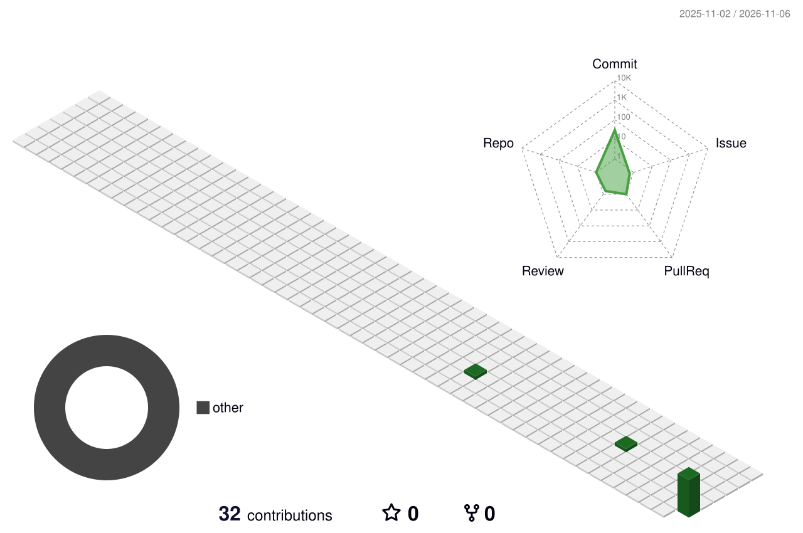

  <picture>
    <source media="(prefers-color-scheme: dark)" srcset="./dark.svg">
    <source media="(prefers-color-scheme: light)" srcset="./light.svg">
    
  </picture>

<strong>FULL-STACK DEVELOPER · UI/UX DESIGNER · AI ENTHUSIAST</strong>

  <a href="#selected-work">SELECTED WORK</a> &nbsp;·&nbsp;
  <a href="#design-case-studies">DESIGN CASE STUDIES</a> &nbsp;·&nbsp;
  <a href="#engineering-toolkit">ENGINEERING TOOLKIT</a> &nbsp;·&nbsp;
  <a href="#contact">CONTACT</a>

  
  
  

## About

I'm **J. Jayawanth**, a final-year Diploma in Computer Networking student at **PSG Polytechnic College, Coimbatore** (2025–2027), building toward a career in software engineering.

I work across the product journey: understanding a problem, shaping the interface, building application experiences, and thinking through the engineering behind them. My interests span **full-stack development, UI/UX design, applied AI, and software systems**.

I value useful products, clear interfaces, maintainable implementation, and honest technical claims.

## Selected work

### 01 — SynDx
**Offline-first clinical decision-support research prototype**

A team project exploring how structured clinical intake, offline workflows, clinician review and a narrow Wilson-disease phenotype research model can fit into one software system.

- **My involvement:** collaborator and author of [merged pull request #1](https://github.com/Creater-jod/synDx/pull/1), opened under the GitHub account **jayawanth3107**.
- **Engineering:** the PR records 5 commits and 356 changed files across application, backend, data/ML pipeline, tests and documentation.
- **Technical focus:** PWA workflows, Node.js/Express, SQLite, Python/FastAPI, model evaluation and safety boundaries.
- **Important scope:** a research prototype, not a clinically validated diagnostic product.

[Project repository](https://github.com/Creater-jod/synDx) · [My merged contribution](https://github.com/Creater-jod/synDx/pull/1) · [Technical case study](./case-studies/syndx.md)

### 02 — Ride Hub
**Flutter workshop technician and service-management app**

A technician-focused app concept that brings daily service tasks, vehicle details, progress tracking, service history, invoice actions and profile management into one workflow.

- **Product experience:** dashboard, task details, history and profile.
- **Interaction design:** task status and progress visibility, simple navigation, invoice/print and re-book actions.
- **Technology:** Flutter.

[Project documentation](./projects/ride-hub/README.md) · [UI/UX case study](./case-studies/ride-hub.md)

### 03 — ColdCall Cloud · SAMG Infotech
**Software Development Internship · Company-owned cloud-calling and CRM product**

Contributed to a review-and-improvement effort for SAMG Infotech's private ColdCall Cloud application. The work focused on understanding an existing codebase, finding usability and quality issues, implementing selected improvements, and preparing the changes for engineering review.

- **Product areas reviewed:** dashboard, dialer workspace, records, team management and settings.
- **Implemented contributions:** interface and responsive-navigation refinements, clearer dashboard information, more responsible dialer scripts, and a backend guard against administrators disabling or removing their own workspace membership.
- **QA work:** documented findings and evidence; added focused unit tests for role rules, membership self-protection, phone normalization, timezone resolution and calling-window helpers.
- **Review status:** proposed changes submitted to the company's original repository for team review; they have not been represented as merged or production-deployed.
- **Project ownership:** SAMG Infotech. The source code is private and is not presented as an independently owned personal project.

## Design case studies

I document the reason behind interface decisions, the main user journeys, the system constraints and what should be tested—not just screenshots.

- [Ride Hub — technician workflow and service history](./case-studies/ride-hub.md)
- [SynDx — low-connectivity clinical workflow and human review](./case-studies/syndx.md)

## Engineering toolkit

| Focus | Technologies and foundations |
|---|---|
| Web development | React, Next.js, TypeScript, JavaScript, HTML5, CSS3, Tailwind CSS |
| Backend and data | Node.js, PostgreSQL, Prisma, MySQL, SQL fundamentals |
| App development | Flutter |
| Programming | Python, C |
| Systems | Linux, Windows |
| Networking | IP addressing, subnetting, routing and switching |
| Workflow | Git, GitHub, debugging, testing and technical documentation |

**How to read this list:** React, Next.js, TypeScript, Node.js, PostgreSQL and Prisma reflect technologies used while contributing to project work. Flutter is used in the Ride Hub app concept. Python, C, MySQL, Linux and networking are part of my current foundations; I keep strengthening them through practical work.

## Collaboration and engineering evidence

My most visible team-collaboration record is [SynDx PR #1](https://github.com/Creater-jod/synDx/pull/1), which was merged on **17 September 2026**. It is a verifiable contribution trail—not a claim that I independently own the entire team repository.

I enjoy collaborating on practical software, learning from code review, and improving the quality of both the user experience and implementation.

## Experience

**Software Development Intern — SAMG Infotech**

Contributed to analysis, UI/UX refinement, selected backend safeguards, focused tests and QA documentation for the company's private ColdCall Cloud product. Submitted proposed changes for team review; final acceptance and release remain with the company.

**App Development Intern — Dextra Technologies, Chennai**

Completed an app development internship and gained practical exposure to application-development workflows.

## Education

**Diploma in Computer Networking**  
PSG Polytechnic College, Coimbatore · 2025–2027 · Final year

**Higher Secondary**  
Sai Vidhiya Nikethan

**Secondary School**  
Sri Chaithaniya Techno School

## Beyond software

- **Languages:** Tamil and English.
- **Football:** two divisional-level wins and one state-level win.
- **Interests:** product building, interface craft, AI technologies, computer systems and continuous learning.

## GitHub activity

  

  
  

## Contact

I'm interested in internships, entry-level software opportunities and collaborations around web products, application development, UI/UX and applied AI.

  

